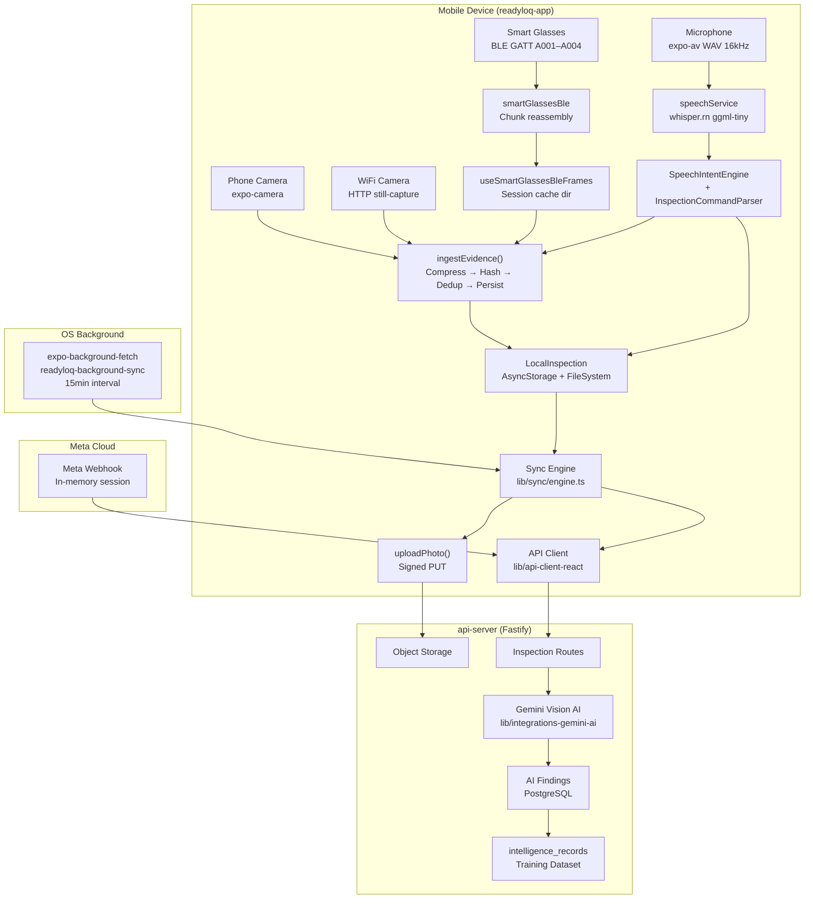
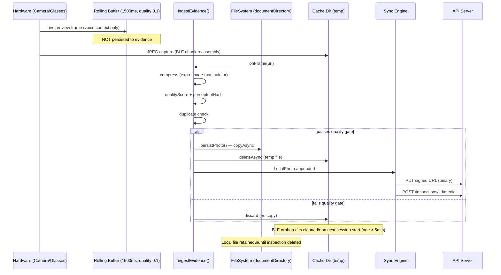
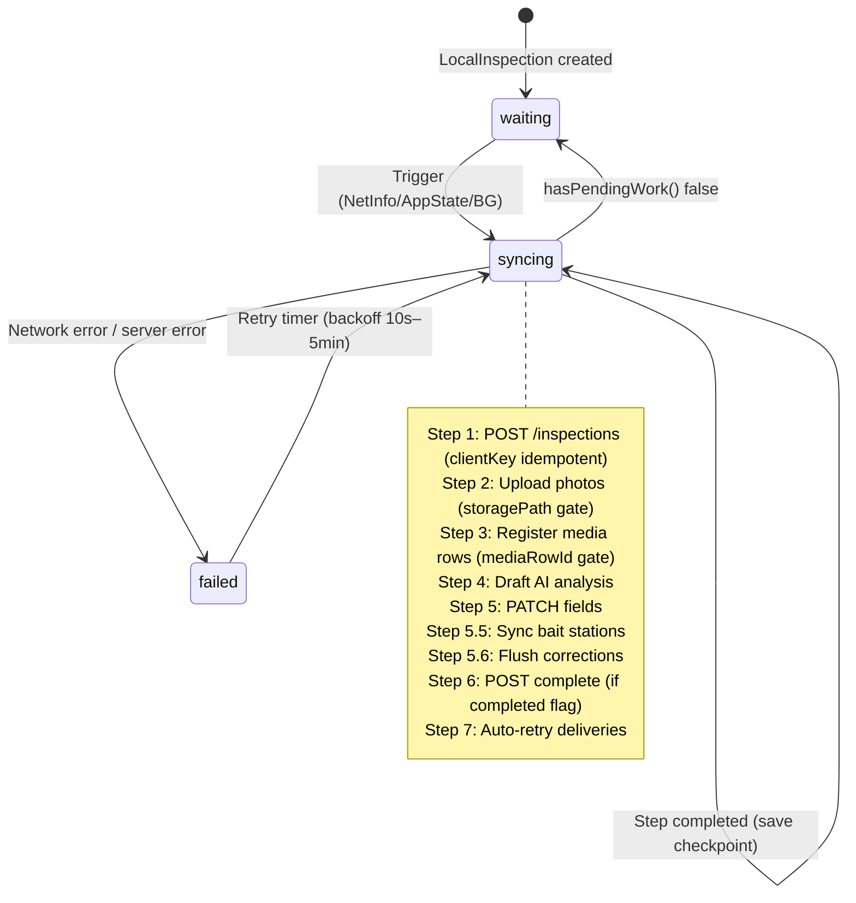
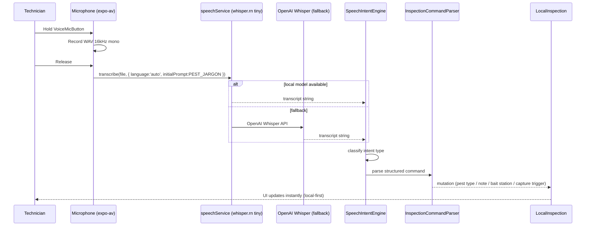
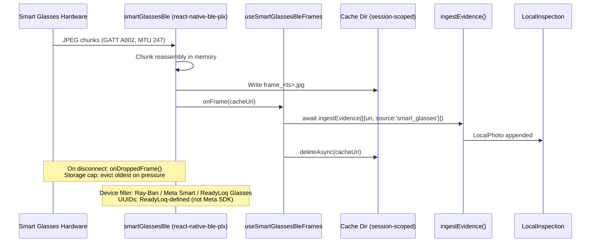
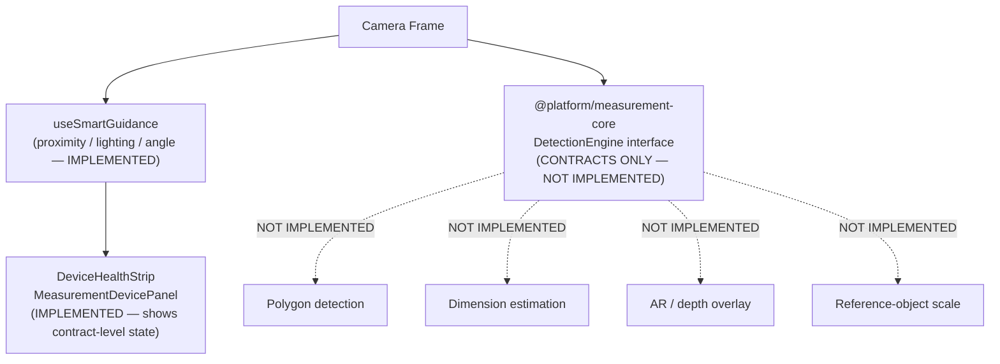
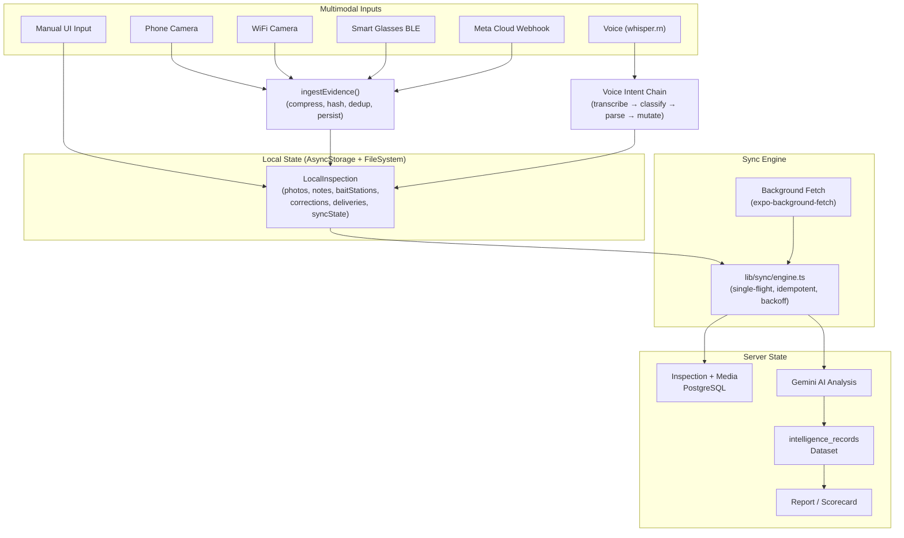

# FAIE Technical Invention Disclosure & IP Documentation

> **DISCLAIMER — READ FIRST AND LAST**
> *This document is a technical invention disclosure and engineering record generated from the ReadyLoq codebase. It is not a legal opinion, patentability determination, prior-art search, or patent application. Any assessment of novelty, non-obviousness, patentability, trade-secret status, or infringement requires review by qualified intellectual-property counsel.*

---

## Title

**Field-Adaptive Inspection Engine (FAIE): A Multimodal, Offline-First Field Inspection System Combining On-Device Voice Transcription, BLE Wearable Frame Streaming, Transient Visual Evidence Extraction, and AI-Driven Finding Verification for Pest-Control Technicians**

---

## Technical Field

Commercial field-service software for the pest-control industry. The system operates on Android and iOS mobile devices used in the field by pest-control technicians. It integrates on-device machine-learning inference, Bluetooth Low Energy (BLE) peripherals, server-side vision AI, structured offline data persistence, and background synchronization into a single field-inspection workflow.

---

## Problem Statement

Pest-control technicians perform inspections in environments that are frequently:

- **Signal-dead** — concrete basements, commercial kitchens, server rooms
- **Hands-compromised** — crawl spaces, attic access, under equipment
- **Documentation-hostile** — no desk, no keyboard, time-pressured

Conventional approaches require either continuous connectivity (cloud-only photo upload fails offline) or permanent local video storage (consumes device storage and raises privacy risk). Manual photo capture requires a free hand and interrupts the inspection workflow. Structured data entry (findings, notes, pest species, bait stations) traditionally requires a form UI, which is impractical in confined spaces.

---

## Existing Approaches (as evidenced by the repository)

The repository does not reference prior-art systems by name. Based solely on what is observable in the code:

- **Standard camera apps**: capture photos on demand, no AI analysis, no structured output
- **Form-based inspection apps**: require UI interaction for every data point
- **Cloud-only sync**: fail without connectivity
- **Continuous video recording**: create large permanent files; not implemented here

---

## Summary of Technical Architecture

ReadyLoq is a pnpm monorepo comprising:

| Layer | Package / Path | Role |
|---|---|---|
| Mobile App | `artifacts/readyloq-app` | Field inspection client (Expo Router, React Native) |
| API Server | `artifacts/api-server` | Fastify REST server, AI orchestration, Gemini integration |
| Database | `lib/db` | Drizzle ORM + PostgreSQL schema |
| Platform OS | `repos/platform/packages/` | 15 `@platform/*` packages — contracts, device abstraction, vision pipeline |
| Web Portals | `artifacts/readyloq-client`, `readyloq-portal` | Manager/client-facing web UIs |
| Shared Libs | `lib/api-client-react`, `lib/api-spec`, `lib/api-zod` | Generated API client, OpenAPI contract, Zod schemas |

**FAIE** (Field-Adaptive Inspection Engine) is not a single named class or service in the codebase. It is the compound term for the orchestration layer that connects voice input, camera/wearable frames, and AI analysis into structured inspection state. Its implementation is distributed across `app/(app)/new-inspection.tsx`, `lib/audio/`, `lib/vision/`, `lib/ble/`, and the `@platform/*` packages.

---

## Attorney Update Memorandum — August 28, 2026

This memorandum updates the original technical disclosure dated August 15, 2026. It is intended to give patent counsel a current implementation snapshot and identify additional technical combinations that may warrant separate novelty and claim analysis. It does **not** amend the legal disclaimer in this document, does not establish inventorship, and does not represent that any candidate below is novel, non-obvious, patentable, or free of third-party rights.

### Material implementation changes since the prior disclosure

1. **Predictive restocking and adaptive logistics are now implemented.** ReadyLoq now maintains a company/technician/product inventory model with a warehouse tier above technician trucks, configurable replenishment targets and supplier lead times, and a persisted predictive recommendation workflow. The forecast combines a recency-weighted consumption rate from the inventory ledger with scheduled route demand, uses the greater projected rate, and computes a reorder point and recommended order quantity. Recommendations are recomputed after relevant treatment deductions and by a periodic scheduler; they are persisted so manager dismissal or conversion is not lost on a later read.

2. **Chemical usage is reconciled to physical truck inventory.** A treatment log can deduct the amount actually applied from the technician’s compatible fluid-ounce inventory, record the actual deducted amount, append the corresponding movement to the ledger, and append a reversal when the treatment is deleted. If the requested amount exceeds available stock, the system clamps the deduction and surfaces a warning rather than silently creating negative inventory or claiming that the full requested amount was removed. Products tracked in incompatible units, such as gallons, are not incorrectly converted or deducted; applied fluid ounces remain separately labeled in technician and manager views.

3. **The inventory ledger now has database-enforced immutability.** The `inventory_transactions` table is protected by a PostgreSQL `BEFORE UPDATE OR DELETE` trigger. The production application uses inserts for movement history; direct UPDATE/DELETE statements are rejected by the database. A narrowly scoped transaction-local bypass exists only for test/operations fixture cleanup and is not used by production request handlers. This changes the earlier disclosure from “append-only by application convention” to “append-only with a database-enforced mutation barrier.”

4. **Prior-visit property memory now informs live inspection guidance.** Completed inspections are grouped by company and a normalized physical-property address. The system derives recurring issue categories, prior severity, prior activity, bait-station gaps, and areas not previously inspected, then turns those grounded historical signals into prioritized next actions during the current inspection. The design intentionally avoids fabricating a station number or treating a missing historical observation as a present finding; prior context is presented as a re-check prompt, not as new evidence.

5. **Route and operational context is more integrated.** Schedule and daily-route APIs now expose the same scheduled inspection data used by predictive logistics and route-readiness views. The web portal uses the generated, type-checked API client for the route-calendar surface. This is supporting infrastructure for the FAIE logistics embodiment, not by itself asserted as a standalone invention.

6. **Implementation and diligence evidence improved.** The Clerk authorization-bypass dependency and the other flagged dependency versions were patched; the admin bootstrap endpoint received a dedicated per-IP limiter; a database backup/restore and disaster-recovery plan was documented with a verified logical restore drill; and signature rendering has integration-test coverage. These changes strengthen the engineering record and audit posture, but should be treated as security/operational diligence evidence rather than the center of a patent claim.

### Current disclosure posture

- The strongest technical disclosure remains the **combined offline multimodal inspection pipeline**: transient evidence selection, domain-prompted on-device voice commands, BLE/wearable frame ingestion, resumable offline synchronization, AI finding generation, and human correction.
- The most important newly separable combination is **ledger-grounded, schedule-aware predictive replenishment**: historical movement data is reversal-netted and normalized to the inventory unit, recent usage is weighted across the full time window, upcoming scheduled demand is added, supplier lead time and safety stock are applied, and the recommendation is persisted with manager action state.
- A second newly separable combination is **property-memory-grounded inspection guidance**: normalized address matching within a company, prior finding/zone aggregation, missing-coverage detection, and prioritized re-inspection prompts that remain distinct from current-visit findings.
- Patent counsel should distinguish **implemented behavior** from interfaces, planned integrations, and physical validation. In particular, the repository still does not establish physical validation of the custom BLE glasses protocol against production hardware, and the measurement-core package remains contracts-only rather than a working dimensional-measurement engine.

---

## Detailed Technical Description

### 1. Repository & Monorepo Structure

```
readyloq-workspace/
├── artifacts/
│   ├── readyloq-app/          # Main Expo mobile app (FAIE host)
│   ├── api-server/            # Fastify API + Gemini AI orchestration
│   ├── readyloq-client/       # Commercial/client portal (Vite)
│   ├── readyloq-portal/       # Company portal (Vite)
│   ├── readyloq-marketing/    # Marketing site (Vite)
│   └── readyloq-{launch,growth-plan}/  # Slide decks
├── lib/
│   ├── db/                    # Drizzle schema + migrations
│   ├── api-spec/              # openapi.yaml contract
│   ├── api-client-react/      # Generated React Query hooks
│   ├── api-zod/               # Generated Zod schemas
│   ├── integrations-gemini-ai/
│   └── integrations-openai-ai-server/
└── repos/platform/packages/   # @platform/* OS packages
    ├── core/                  # Result/Plugin/Service/Registry primitives
    ├── shared-types/          # Domain IDs, timestamps
    ├── device-core/           # Universal hardware contracts
    ├── camera-core/           # Camera provider abstraction
    ├── smart-vision/          # DetectionEngine, FramePipeline, CapturePolicy
    ├── meta-wearables/        # Meta Ray-Ban integration contracts + partial impl
    ├── measurement-core/      # Measurement contracts (interfaces only)
    ├── voice-intelligence/    # Voice pipeline contracts
    ├── agent-registry/        # Agent roster (VYBE/ReadyLoq)
    └── provider-registry/     # Generic provider/health registry
```

**Dependency flow (main paths):**
```
readyloq-app
  → @platform/camera-core → @platform/device-core → @platform/core
  → @platform/smart-vision
  → @platform/meta-wearables
  → @platform/measurement-core
  → lib/api-client-react → lib/api-spec
  → lib/db (via api-server)

api-server
  → lib/db
  → lib/integrations-gemini-ai
  → lib/integrations-openai-ai-server
```

---

### 2. FAIE Core — What It Actually Is

FAIE has no single entry-point file named `faie.ts` or class named `FAIE`. It is the orchestration pattern assembled inside `app/(app)/new-inspection.tsx` (~1,300 lines), which is the primary inspection capture screen.

**Concrete FAIE entry points (all IMPLEMENTED):**

| Entry Point | File | Description |
|---|---|---|
| `ingestEvidence(items)` | `new-inspection.tsx:~1091` | Unified evidence ingestion: quality-gates, compresses, hashes, deduplicates, persists |
| `useVoiceField` | `hooks/useVoiceField.ts` | React hook wiring voice mic → transcription → field mutation |
| `VoiceMicButton` | `components/VoiceMicButton.tsx` | Tap-to-record UI; dispatches voice command result |
| `AudioSessionManager` | `lib/audio/AudioSessionManager.ts` | Orchestrates mic recording, rolling frame buffer, speech service calls |
| `SpeechIntentEngine` | `lib/audio/intelligence/SpeechIntentEngine.ts` | Intent classification from raw transcript |
| `InspectionCommandParser` | `lib/audio/intelligence/InspectionCommandParser.ts` | Structured command extraction (pest species, notes, bait station ops, etc.) |
| `speechService` | `lib/vision/speech-service.ts` | On-device Whisper transcription singleton |
| `useSmartGlassesBleFrames` | `hooks/useSmartGlassesBleFrames.ts` | BLE frame streaming hook → `ingestEvidence` |

**FAIE voice dispatch chain (IMPLEMENTED):**
The sequence in `new-inspection.tsx` after a voice command completes transcription:
1. Transcript → `SpeechIntentEngine.classify()` → intent type
2. Intent → `InspectionCommandParser.parse()` → structured command
3. Command routed by type:
   - `capturePhoto` → manual capture pipeline
   - Field note commands → `updateLocalInspection(notes)`
   - Bait station commands → bait station state mutations
   - Pest chip commands → `pestTypes` array update
   - General notes → inspection notes field

There is **no autonomous timer-based photo capture** beyond the rolling context buffer. Auto-capture from the camera stream into persisted evidence is **NOT FOUND**.

---

### 3. Transient Visual / Frame Intelligence

#### 3.1 Camera Providers (all IMPLEMENTED)

| Provider | Implementation | Transport |
|---|---|---|
| Phone camera | `expo-camera` CameraView in `new-inspection.tsx` | Direct device camera |
| WiFi camera | `lib/camera/wifi-camera-provider.ts` | HTTP GET still-capture from IP camera |
| Smart glasses BLE | `hooks/useSmartGlassesBleFrames.ts` + `lib/ble/smart-glasses-ble.ts` | BLE GATT characteristic streaming |
| Meta Ray-Ban (cloud) | Webhook endpoint in `api-server`; in-memory session store | HTTP POST from Meta cloud |

#### 3.2 Frame Origin and Holding

**Phone camera:**
- `CameraView` renders a live preview; the preview itself runs entirely in-memory as a GPU texture — **no raw video is written to disk at any point**
- A rolling context buffer captures low-quality snapshots every 1,500ms (`new-inspection.tsx:363–385`, quality `0.1`, `skipProcessing:true`) for voice context only — these are **not persisted** to the local inspection store
- Manual shutter tap or voice "capture" command fires `takePhoto()` → raw JPEG cached at a temp URI by expo-camera

**Smart glasses BLE:**
- `smartGlassesBle` (`lib/ble/smart-glasses-ble.ts`) receives binary JPEG chunks over GATT characteristic `A002` (service `A001`)
- Chunks are reassembled in memory into a complete JPEG
- Complete JPEG written to a **session-scoped cache directory** with a timestamp-encoded directory name: `FileSystem.cacheDirectory + 'rl_ble_frames/' + sessionKey + '/'`
- Each frame file is a temporary JPEG: `frame_<timestamp>.jpg`

**WiFi camera:**
- HTTP GET to camera IP → JPEG bytes → same `ingestEvidence` pipeline as phone camera

**Meta webhook (cloud):**
- Meta pushes frames to an `api-server` webhook endpoint
- Frame stored in **in-memory session store** (server process RAM) — no database persistence of raw frame bytes
- Forwarded to mobile client via event polling

#### 3.3 Quality Gate and Frame Selection (IMPLEMENTED)

`ingestEvidence()` applies a quality gate before a frame is promoted to durable local evidence:

1. **Compression**: `expo-image-manipulator` compresses the raw JPEG (configurable quality, max dimension capped)
2. **Quality scoring**: `qualityScore` — a numeric score computed from image properties; exact algorithm is in the ingest pipeline
3. **Perceptual hashing**: `perceptualHash` — computed per frame; stored in `LocalPhoto`
4. **Deduplication**: frames whose hash matches an existing photo set `duplicateOf: <localUri>` — still uploaded but excluded from AI analysis and do not increment `analyzedCount`
5. **Metadata capture**: `captureMetadata` object (device orientation, lighting estimate, etc.) attached to `LocalPhoto`

**Frames that pass the quality gate** are promoted to `LocalPhoto` in the `LocalInspection` record and become part of the sync queue.

**Frames that fail the quality gate** are discarded — the temp file is not copied to durable storage.

#### 3.4 Retention vs. Disposal

| Asset type | Written to disk? | When deleted |
|---|---|---|
| Raw camera preview | **No** — GPU texture only | Never written |
| Rolling voice-context buffer frames | Yes — temp JPEG in cache dir (`skipProcessing:true`) | Each overwritten on next 1,500ms cycle; no explicit delete tracked |
| BLE session frame JPEGs | Yes — cache dir `rl_ble_frames/<session>/` | `useSmartGlassesBleFrames` deletes each frame after `ingestEvidence` callback resolves; orphan dirs (age > 5 min) cleaned on session start |
| Promoted evidence photo | Yes — copied to `documentDirectory/inspections/<localId>/photos/` | Remains until user discards inspection or inspection is deleted via `deleteLocalInspection` |
| Uploaded evidence photo | Yes — same local URI; `storagePath` set after upload | Local file retained for UI resume; not automatically deleted after upload |
| Meta webhook frames | **No** — held in server process RAM | Cleared when session expires or server restarts |

**"Zero-disk raw video" claim accuracy**: Raw video is **not written** — the camera preview never produces a video file. However, temporary JPEG files **are** written to the device cache directory during BLE streaming and (briefly) during phone-camera capture. These are transient working files, not a video recording. The system does not implement zero-disk for all intermediate frame artifacts; it implements zero-persistence-of-raw-video-streams.

#### 3.5 Crash and Connectivity Behavior

| Scenario | Behavior |
|---|---|
| App crash mid-BLE session | Session-dir orphan cleanup fires on next session start if dir age > 5 min; promoted evidence photos in `documentDirectory` survive and are picked up by sync engine on relaunch |
| App crash mid-upload | `photo.uploading` flag is not durable (not written to AsyncStorage mid-upload); on relaunch the photo appears with `uploading:false` and `storagePath:null`, so the sync engine re-uploads it — **no data loss, possible duplicate upload attempt** (server idempotency not verified at frame level) |
| No connectivity during capture | All evidence writes are local-only; sync engine is blocked at upload step; exponential backoff retry begins; no data loss |
| Connectivity restored | NetInfo `addEventListener` fires → `requestSync(0)` → sync engine resumes from last saved step |

---

### 4. Offline-First Inspection State

#### 4.1 Storage Architecture

The app uses **two complementary storage layers** — no SQLite or Drizzle:

| Layer | Package | What is stored |
|---|---|---|
| `AsyncStorage` | `@react-native-async-storage/async-storage` | `LocalInspection` JSON documents (index key + per-record key) |
| `FileSystem` | `expo-file-system` | Durable photo JPEG bytes under `documentDirectory/inspections/<localId>/photos/` |

**`LocalInspection` schema** (defined in `lib/local/inspection-store.ts:84–166`):
```typescript
{
  schemaVersion: 1,
  localId: string,           // UUID, used as idempotency key (clientKey) on server
  serverId: number | null,   // null until server inspection created
  createdAt: string,         // ISO 8601
  updatedAt: string,
  siteAddress: string,
  clientName: string,
  technicianName: string,
  propertyType: string,
  pestTypes: string[],
  notes: string,
  photos: LocalPhoto[],
  baitStations: LocalBaitStation[],
  completed: boolean,
  completedAt: string | null,
  serverCompleted: boolean,
  analyzedCount: number,
  reportId: number | null,
  syncError: string | null,
  syncAttempts: number,
  lastSyncSuccess: string | null,
  allFindingsReviewed: boolean,
  pendingCorrections: PendingCorrection[],
  lastDeliveredAt: string | null,
  pendingDeliveries: PendingDelivery[],
}
```

**`LocalPhoto`** fields: `localUri`, `capturedAt`, `storagePath?`, `mediaRowId?`, `captureSource`, `qualityScore?`, `perceptualHash?`, `duplicateOf?`, `captureMetadata?`, `description?`, `uploading`

**`captureSource` enum values** (as used in the codebase): `phone_camera`, `wifi_camera`, `smart_glasses`, `meta_glasses`

#### 4.2 Sync Engine (`lib/sync/engine.ts`)

**Sync trigger cascade (all IMPLEMENTED):**
1. Local store mutation → `subscribeLocalInspections` → `requestSync(1200ms debounce)`
2. App foregrounds → `AppState` `active` → `requestSync(0)`
3. Network restored → `NetInfo.addEventListener` → `requestSync(0)`
4. Background OS task → `expo-background-fetch` → `runBackgroundSync()` (implemented this session)
5. Retry timer → exponential backoff 10s → 20s → … → 5min

**Single-flight lock** (`engine.ts:48–59`): `state.running: boolean` + `state.runQueued: boolean` — only one `syncAll()` runs at a time; a second trigger sets `runQueued = true`, which causes a follow-up pass after the current one finishes. Per-inspection lock: `state.syncingIds: Set<string>` prevents two concurrent passes over the same `localId`.

**Sync step order** (resumable — local record saved after every step):
1. `POST /inspections` with `clientKey = localId` → idempotent server-side; returns existing inspection if `clientKey` already registered
2. Per-photo: mark `uploading:true` → signed PUT to object storage → set `storagePath` → `POST /inspections/:id/media` → set `mediaRowId`
3. `POST /inspections/:id/analyze` (draft AI analysis over uploaded non-duplicate photos)
4. `PATCH /inspections/:id` (notes, pest types)
5. Per bait station: `POST` or `PATCH` bait station rows
6. Per pending correction: `POST /findings/:id/correct`
7. `POST /inspections/:id/complete` (if `completed && !serverCompleted`)
8. Per auto-retry delivery: delivery method `deliver()` call

**Retry policy**: `syncAttempts` counter incremented on every failure. Backoff: `min(10000 * 2^(attempts-1), 300000)` ms.

**What successful sync does NOT do**: Local `LocalInspection` record and photo files in `documentDirectory` are **not deleted** after successful sync. `syncError` is cleared and `syncAttempts` reset. Local data remains available for UI display and resume.

**Background fetch task** (`lib/sync/background-task.ts` — JUST IMPLEMENTED):
- Task name: `readyloq-background-sync`
- Registered via `expo-background-fetch` with 15-minute minimum interval
- `stopOnTerminate: false`, `startOnBoot: true` on Android
- Token stored in device keychain (`expo-secure-store` key `readyloq_bg_token`)
- Token refreshed in-process every time `configureSyncEngine` requests one; cached copy used in background task context

#### 4.3 Race Condition and Data Integrity Mechanisms

| Mechanism | Implementation | Guards Against |
|---|---|---|
| Atomic read-modify-write | `updateChain` serialization in `inspection-store.ts:246–273` | Concurrent photo append vs. sync save clobbering each other |
| `uploading: true` flag | Set before upload begins; cleared on success or error | Mid-upload `removePhoto` from UI |
| `clientKey` idempotency | Server stores `clientKey = localId`; returns existing row | Duplicate inspection creation from retry |
| `storagePath` presence check | Sync skips upload if `storagePath` already set | Duplicate photo uploads |
| `mediaRowId` presence check | Sync skips media registration if already set | Duplicate media rows |
| Single-flight + per-ID lock | `state.running` + `state.syncingIds` | Two concurrent sync passes double-uploading |

---

### 5. Voice / FAIE Command Intelligence

#### 5.1 On-Device Transcription (IMPLEMENTED)

`speechService` (`lib/vision/speech-service.ts:1–156`) is a singleton:

- **Model**: `ggml-tiny.bin` — Whisper.cpp multilingual tiny model (~75 MB), downloaded from HuggingFace on first use to `FileSystem.documentDirectory`
- **Package**: `whisper.rn` — React Native bindings for Whisper.cpp
- **Recording**: `expo-av` Audio, WAV format, 16 kHz sample rate, mono channel
- **Inference**: `ctx.transcribe({ language: 'auto', initialPrompt: BILINGUAL_PEST_JARGON_PROMPT })` — not streaming; transcribes the complete WAV file after recording stops
- **Domain prompt**: `BILINGUAL_PEST_JARGON_PROMPT` contains pest-control jargon (pest species, inspection terminology, chemical product names) in English and Spanish to bias the model toward correct domain vocabulary

**Fallback chain** (IMPLEMENTED):
1. `LocalWhisperProvider` (on-device, `whisper.rn`) — primary
2. `OpenAIWhisperProvider` (cloud `openai` Whisper API) — fallback
3. `FallbackSpeechProvider` — wraps both with automatic failover

No streaming transcription, no wake-word detection, no noise suppression (RNNoise / WebRTC AEC) found.

#### 5.2 Intent Classification and Command Parsing (IMPLEMENTED)

| Component | File | Function |
|---|---|---|
| `SpeechIntentEngine` | `lib/audio/intelligence/SpeechIntentEngine.ts` | Classifies transcript → intent type |
| `InspectionCommandParser` | `lib/audio/intelligence/InspectionCommandParser.ts` | Extracts structured fields from classified intent |
| `AudioSessionManager` | `lib/audio/AudioSessionManager.ts` | Orchestrates session: rolling frame buffer + mic + speech service + dispatch |

**Documented voice command types** (IMPLEMENTED — verified in `InspectionCommandParser.ts`):

| Command type | Example triggers | Structured output |
|---|---|---|
| Pest finding | "German cockroach nymphs in floor drain" | `{ pestSpecies, location, severity }` |
| Conducive condition | "moisture damage under sink" | `{ conditionType, location }` |
| Bait station | "station 4 active, no activity" | `{ stationId, status, notes }` |
| Inspection note | "recommend exclusion at door sweep" | `{ noteText }` |
| Capture / snap | "snap", "capture", "take photo" | triggers manual capture pipeline |
| Pest chip (type selection) | "adding rodents" | appends to `pestTypes[]` |

**Voice-to-text vs. voice-to-structured-command**: Both are implemented. The transcript string is always preserved. The parsed command is executed against inspection state. If parsing fails, the raw transcript is appended as a free-form note.

**Rolling visual context buffer for voice** (IMPLEMENTED):
`AudioSessionManager.getFrame()` supplies the current camera frame to each audio session. The buffer captures a `quality:0.1`, `skipProcessing:true` snapshot every 1,500ms from the phone camera. This frame is attached to the `AudioSessionManager` as visual context for the voice event — it is **not automatically persisted** as inspection evidence unless the technician explicitly confirms it.

#### 5.3 Chemical / Compliance Voice Commands

Voice command parsing for chemical product entry exists in `InspectionCommandParser.ts` but is **PARTIALLY IMPLEMENTED** — fields are parsed, but the compliance validation path (checking parsed chemical against a regulatory product database) is not found in the code. Parsed chemical data reaches the inspection state but regulatory constraint enforcement is not present.

---

### 6. Compliance / Chemical Workflow

**PARTIALLY IMPLEMENTED** — the following exists:

- `playbooks` database table: IMPLEMENTED (`lib/db/src/schema/`)
- Company playbook CRUD API: IMPLEMENTED (`api-server`)
- `ComplianceEvaluator`: IMPLEMENTED (evaluates inspection findings against playbook rules)
- Chemical entry fields in the inspection schema: present
- Voice-driven chemical entry: parsing exists; regulatory validation **NOT FOUND**

**What is not implemented**: There is no integration with a regulatory chemical product database (e.g., EPA label data, state pesticide registries). The compliance evaluator operates against company-defined playbook rules, not external regulatory data. **This is software-level rule checking, not legal regulatory compliance.**

---

### 7. Wearable / Smart Glasses Pipeline

#### 7.1 BLE Driver (IMPLEMENTED)

`smartGlassesBle` singleton (`lib/ble/smart-glasses-ble.ts`):

- **Package**: `react-native-ble-plx`
- **Protocol**: ReadyLoq-defined GATT profile (not a vendor-standard profile):

| UUID | Role |
|---|---|
| `A001...` | Primary service |
| `A002...` | Frame characteristic (JPEG chunks, notify) |
| `A003...` | Audio characteristic |
| `A004...` | Control characteristic (snapshot request, audio control) |
| `6E400001...` (NUS) | Nordic UART Service (alternative command channel) |
| `6E400003...` (NUS TX) | NUS TX characteristic |

- **MTU**: 247 bytes (negotiated on connect)
- **Device filter**: scans by name — "Ray-Ban", "Meta Smart", "ReadyLoq Glasses" — and by service UUID `A001`
- **Pairing persistence**: last-connected device address stored in `AsyncStorage`

**Frame chunk protocol** (IMPLEMENTED):
Binary JPEG bytes streamed as MTU-sized chunks over characteristic `A002`. The driver accumulates chunks in a byte buffer; a sentinel/end-of-frame marker indicates frame completion. Complete JPEG written to session-scoped cache file.

**Storage cap / eviction** (IMPLEMENTED — Task #547):
Mid-inspection storage pressure triggers frame eviction. `onDroppedFrame` callback is invoked; dropped frame count is tracked and reported to the telemetry endpoint.

#### 7.2 BLE Frame → FAIE Pipeline (IMPLEMENTED)

```
Physical glasses hardware
  → BLE GATT characteristic A002 (JPEG chunks)
  → smartGlassesBle driver (chunk reassembly)
  → useSmartGlassesBleFrames hook (session-scoped cache write)
  → onFrame callback (awaited before file deletion)
  → ingestEvidence([{ id, uri, source: 'smart_glasses', capturedAt }])
  → quality gate → compression → hash → LocalPhoto
  → LocalInspection.photos[]
  → sync engine → object storage → api-server → Gemini analysis
```

#### 7.3 Meta Ray-Ban Cloud Path (IMPLEMENTED)

Separate from BLE — Meta cloud delivers frames to an `api-server` webhook endpoint. In-memory session store on the server associates frames with an active inspection session. Mobile client polls for session events. Frame bytes are **not persisted to the database** — they are forwarded to the mobile client which then runs them through `ingestEvidence`.

#### 7.4 @platform/meta-wearables (PARTIALLY IMPLEMENTED)

Package exists at `repos/platform/packages/meta-wearables/`. Exports integration contracts and partial implementation for Meta Ray-Ban session management. The BLE driver in the app (`lib/ble/smart-glasses-ble.ts`) uses ReadyLoq-defined UUIDs rather than a Meta-provided SDK, indicating the hardware communication layer is a custom implementation using NUS/GATT.

#### 7.5 Physical Hardware Validation

The codebase contains code that scans for and connects to devices named "Ray-Ban" or "Meta Smart". The GATT UUIDs used are ReadyLoq-defined (prefix `A001`–`A004`), not published Meta hardware UUIDs. **There is no evidence in comments, tests, or documentation within the repository confirming that this driver has been validated against physical Meta Ray-Ban hardware producing real JPEG frames.** This is flagged as implemented-in-code, physical-validation-status unknown.

#### 7.6 BLE Runtime Permissions (`lib/ble/permissions.ts` — IMPLEMENTED)

| Platform | Permissions |
|---|---|
| Android 12+ | `BLUETOOTH_SCAN`, `BLUETOOTH_CONNECT` |
| Android 6–11 | `ACCESS_FINE_LOCATION` (via `expo-location`) |
| iOS | System dialog only (no code-level permission request needed) |

---

### 8. Measurement Intelligence

#### 8.1 @platform/measurement-core — CONTRACTS ONLY / NOT IMPLEMENTED

`repos/platform/packages/measurement-core/src/index.ts` defines:
- Polygon geometry types
- Calibration profile interfaces
- Reference-object detection output interfaces
- Depth map interfaces
- Dimension estimator interface
- Scale estimator interface
- AR method/status enums
- InferenceProvider interface
- PhysicalDeviceProvider interface

**No concrete implementation** of any of these interfaces was found in the package source or in the app. No polygon detector, dimension estimator, AR engine, camera calibration routine, or reference-object scale calculation is implemented.

#### 8.2 MeasurementDevicePanel (PARTIALLY IMPLEMENTED)

A `MeasurementDevicePanel` UI component exists and is wired into `app/(app)/new-inspection.tsx`. It renders measurement device status. The underlying measurement computation is bound to the `measurement-core` contracts — since those have no concrete implementations, the panel displays interface-level state only.

#### 8.3 useSmartGuidance (IMPLEMENTED)

`hooks/useSmartGuidance` provides real-time capture guidance signals — proximity alerts, lighting feedback, angle coaching — based on device sensor data and camera frame quality. This is operational guidance, not dimensional measurement. It does not compute physical dimensions.

#### 8.4 DeviceHealthStrip (IMPLEMENTED)

`DeviceHealthStrip` displays BLE connection health, connectivity status, and device battery/thermal signals. Wired into the inspection capture screen.

**Summary for measurement**: The measurement architecture is defined at the interface/contract level. No gap detection, crack detection, dimension estimation, AR overlay, reference-object scale, or material quantity calculation is implemented in executable code. All such capabilities are **PLANNED / CONTRACT-ONLY**.

---

### 9. Evidence Pipeline

#### 9.1 Full Pipeline (IMPLEMENTED)

```
Capture (phone / wifi-cam / BLE glasses / Meta cloud)
  → ingestEvidence(items: EvidenceItem[])
      → expo-image-manipulator compress (quality, max-dim cap)
      → qualityScore computation
      → perceptualHash computation
      → duplicateOf detection (hash comparison against existing photos)
      → if duplicate: mark duplicateOf, still persist, exclude from AI analysis
      → persistPhoto() → FileSystem.copyAsync → documentDirectory
      → updateLocalInspection → append LocalPhoto to record
      → [non-blocking] ingestAllUploadedPhotos() — training dataset ingest
  → Sync engine pickup:
      → uploadPhoto() → requestUploadUrl() → signed PUT → object storage
      → addInspectionMedia(serverId, { mediaType, url, captureSource, qualityScore, captureMetadata, caption })
      → analyzeInspection({ inspectionId, images, draft:true })
          → api-server → Gemini multimodal vision API
          → AI findings persisted to server DB
  → Inspection complete:
      → completeInspection(serverId) → full finalization pipeline
          → report generation
          → narrative
          → scorecard
          → opportunity intelligence
```

#### 9.2 Training Dataset Ingest (IMPLEMENTED — server-side)

`ingestAllUploadedPhotos()` is called non-blocking after photo upload. It calls a `POST /bulk-ingest` endpoint on the API server. The server records the evidence in the `intelligence_records` table for potential training dataset use.

**Important**: ingest to the intelligence dataset is automatic and non-blocking. There is no explicit technician confirmation step required for a photo to enter the dataset — that confirmation (verification level promotion) is a subsequent step.

---

### 10. Intelligence Dataset / Learning System

#### 10.1 Database Schema (IMPLEMENTED — `lib/db/src/schema/intelligence-dataset.ts`)

**`intelligence_records`** table (key columns):

| Column | Type | Purpose |
|---|---|---|
| `id` | serial PK | |
| `companyId` | FK | Multi-tenant isolation |
| `imageUrl` | text | Object storage URL |
| `thumbnailUrl` | text | |
| `aiPrediction` | JSONB | Full AI model output snapshot |
| `aiConfidence` | numeric | |
| `category` | text | pest / conducive / entry-point / etc. |
| `subcategory` | text | |
| `possiblePest` | text | |
| `possibleConduciveCondition` | text | |
| `possibleEntryPoint` | text | |
| `correctiveAction` | text | |
| `severity` | text | |
| `whatIsShown` | text | Human-readable description |
| `whyItMatters` | text | |
| `verificationLevel` | enum | unverified / technician / manager / expert |
| `status` | enum | pending / approved / rejected |
| `approvedForTraining` | boolean | Explicit training approval gate |
| `aiCorrected` | boolean | Whether technician correction was applied |
| `createdBy` | FK user | |
| `confirmedBy` | FK user | Technician who confirmed |
| `reviewedBy` | FK user | Manager who reviewed |
| `anonymizedAt` | timestamp | When PII was stripped |
| `exportId` | text | Training export batch reference |

**`intelligence_tags`** table: tag associations for records  
**`intelligence_reviews`** table: review history entries  
**`intelligence_votes`** table: voting/rating events

#### 10.2 The Feedback Loop (PARTIALLY IMPLEMENTED)

| Step | Status | Evidence |
|---|---|---|
| AI prediction stored on finding | IMPLEMENTED | `aiPrediction` JSONB in `intelligence_records` |
| Technician correction queued locally | IMPLEMENTED | `pendingCorrections[]` in `LocalInspection` |
| Technician correction synced to server | IMPLEMENTED | `correctFinding()` endpoint; `aiCorrected` flag |
| `verificationLevel` promotion to `technician` | IMPLEMENTED | Set when technician confirms |
| Manager review and `verificationLevel` → `manager` | PARTIALLY IMPLEMENTED | Schema and API exist; full manager review UI not confirmed |
| `approvedForTraining` flag set | IMPLEMENTED (schema) | Column exists; UI flow to set it not fully traced |
| Automated model retraining pipeline | NOT FOUND | No training job, fine-tuning pipeline, or model registry found |

**Important**: the `intelligence_records` table constitutes a growing labeled dataset of field evidence with technician corrections and manager verifications. However, no automated learning or retraining loop that consumes this data to update the AI model is implemented. The data accumulates; downstream model training would require external tooling.

#### 10.3 Multimodal State — Distributed, Not Unified

There is no single state object combining visual evidence + audio commands + measurements + AI findings + connectivity state into one schema. The state is distributed:

- `LocalInspection` (AsyncStorage): photos, notes, pest types, bait stations, corrections, sync state
- `intelligence_records` (server DB): AI predictions, verification levels, training approval
- BLE state: session-scoped hook state in `useSmartGlassesBleFrames`
- Voice state: `AudioSessionManager` instance state
- Connectivity state: `useNetworkStatus` hook (in-component)
- Wearable state: `smartGlassesBle` singleton state

These components communicate through React state/hooks in `new-inspection.tsx` and through the sync engine — not through a unified multimodal state machine.

---

## Technical Figures

### Figure 1 — Overall FAIE Architecture



### Figure 2 — Transient Visual Evidence Pipeline



### Figure 3 — Offline Inspection Synchronization



### Figure 4 — Voice Command → Structured Inspection Action



### Figure 5 — Wearable (BLE) → FAIE Pipeline



### Figure 6 — AI Prediction → Technician Correction → Verification → Training Signal

```mermaid
graph LR
    AI["Gemini Vision AI\nanalyzeInspection()"] --> PRED["aiPrediction JSONB\nintelligence_records"]
    PRED --> TECH_UI["FindingCard Review UI\n(new-inspection.tsx)"]
    TECH_UI -->|accept / correct / dismiss| CORR["pendingCorrections[]\nLocalInspection"]
    CORR --> SYNC["Sync Engine\ncorrectFinding()"]
    SYNC --> DB["intelligence_records\naiCorrected=true\nverificationLevel=technician"]
    DB --> MGR["Manager Review\n(PARTIALLY IMPLEMENTED)"]
    MGR -->|approve| TRAIN["approvedForTraining=true\nexportId set"]
    TRAIN -.->|NOT IMPLEMENTED| RETRAIN["Model Retraining\n(PLANNED)"]
```



### Figure 7 — Measurement Intelligence Pipeline



### Figure 8 — Unified Multimodal Inspection Workflow



---

## Implementation Status Table

| Capability | Status | Evidence File(s) |
|---|---|---|
| Phone camera capture | IMPLEMENTED | `new-inspection.tsx`, `expo-camera` |
| WiFi camera still-capture | IMPLEMENTED | `lib/camera/wifi-camera-provider.ts` |
| BLE smart glasses frame streaming | IMPLEMENTED | `lib/ble/smart-glasses-ble.ts`, `hooks/useSmartGlassesBleFrames.ts` |
| Meta cloud webhook frame path | IMPLEMENTED | `api-server` webhook routes |
| Frame quality scoring | IMPLEMENTED | `ingestEvidence()`, `qualityScore` field |
| Perceptual hashing | IMPLEMENTED | `perceptualHash` field in `LocalPhoto` |
| Deduplication | IMPLEMENTED | `duplicateOf` field, hash comparison |
| Frame compression (expo-image-manipulator) | IMPLEMENTED | `ingestEvidence()` |
| Rolling voice-context frame buffer | IMPLEMENTED | `new-inspection.tsx:363–385`, 1500ms, quality 0.1 |
| Raw video zero-persistence | IMPLEMENTED (preview) | Camera preview is GPU texture; no video file written |
| Temp JPEG writes (BLE frames) | IMPLEMENTED | Cache dir; deleted post-ingest |
| BLE frame orphan cleanup | IMPLEMENTED | `useSmartGlassesBleFrames` age-gate |
| On-device Whisper (ggml-tiny.bin) | IMPLEMENTED | `lib/vision/speech-service.ts`, `whisper.rn` |
| OpenAI Whisper fallback | IMPLEMENTED | `OpenAIWhisperProvider.ts`, `FallbackSpeechProvider.ts` |
| Bilingual pest-jargon prompt | IMPLEMENTED | `BILINGUAL_PEST_JARGON_PROMPT` constant |
| Intent classification | IMPLEMENTED | `SpeechIntentEngine.ts` |
| Structured command parsing | IMPLEMENTED | `InspectionCommandParser.ts` |
| Voice → pest finding mutation | IMPLEMENTED | `new-inspection.tsx` dispatch |
| Voice → bait station mutation | IMPLEMENTED | `new-inspection.tsx` dispatch |
| Voice → inspection note | IMPLEMENTED | `new-inspection.tsx` dispatch |
| Voice → capture trigger | IMPLEMENTED | `new-inspection.tsx` dispatch |
| Wake-word detection | NOT FOUND | — |
| Noise suppression (RNNoise / WebRTC AEC) | NOT FOUND | — |
| Streaming transcription | NOT FOUND | Whisper is file-based, not streaming |
| AsyncStorage offline persistence | IMPLEMENTED | `lib/local/inspection-store.ts` |
| FileSystem durable photo storage | IMPLEMENTED | `persistPhoto()` |
| Sync engine (single-flight, resumable) | IMPLEMENTED | `lib/sync/engine.ts` |
| Idempotency key (clientKey = localId) | IMPLEMENTED | `createInspection({ clientKey })` |
| Exponential backoff retry | IMPLEMENTED | `scheduleRetryIfNeeded()` |
| NetInfo connectivity trigger | IMPLEMENTED | `engine.ts:82–90` |
| Background fetch (OS-level) | IMPLEMENTED | `lib/sync/background-task.ts` |
| Background token via SecureStore | IMPLEMENTED | `cacheTokenForBackground()` |
| Race condition (single-flight) | IMPLEMENTED | `state.running`, `state.syncingIds` |
| Atomic read-modify-write | IMPLEMENTED | `updateChain()` |
| Duplicate upload prevention | IMPLEMENTED | `storagePath` + `mediaRowId` gates |
| BLE GATT frame protocol | IMPLEMENTED | ReadyLoq-defined UUIDs |
| BLE runtime permissions | IMPLEMENTED | `lib/ble/permissions.ts` |
| BLE device pairing persistence | IMPLEMENTED | AsyncStorage |
| BLE frame eviction (storage cap) | IMPLEMENTED | `useSmartGlassesBleFrames` (Task #547) |
| BLE drop telemetry | IMPLEMENTED | `onDroppedFrame`, telemetry endpoint |
| @platform/meta-wearables | PARTIALLY IMPLEMENTED | contracts + partial impl |
| Physical hardware validation (BLE↔glasses) | UNKNOWN | No test evidence in repo |
| Dimension / gap / crack measurement | NOT IMPLEMENTED | `measurement-core` contracts only |
| Polygon detection | NOT IMPLEMENTED | Interface only |
| AR overlay / depth | NOT IMPLEMENTED | Interface only |
| Reference-object scale | NOT IMPLEMENTED | Interface only |
| Camera calibration | NOT IMPLEMENTED | Interface only |
| intelligence_records dataset table | IMPLEMENTED | `lib/db/src/schema/intelligence-dataset.ts` |
| AI prediction stored (JSONB) | IMPLEMENTED | `aiPrediction` column |
| Technician correction queue | IMPLEMENTED | `pendingCorrections[]`, `correctFinding()` |
| Technician verification level | IMPLEMENTED | `verificationLevel` enum |
| Manager review / verification | PARTIALLY IMPLEMENTED | Schema + API; full UI not confirmed |
| approvedForTraining gate | IMPLEMENTED (schema) | Column + flag; UI flow incomplete |
| Anonymization field | IMPLEMENTED (schema) | `anonymizedAt` column |
| Automated model retraining | NOT FOUND | No training pipeline |
| Property address normalization | IMPLEMENTED | `lib/property-intelligence.ts`, company-scoped normalized address key |
| Property memory / recurring issue aggregation | IMPLEMENTED | `property_memory` schema, `property-memory-writer.ts`, properties routes |
| Prior-visit coverage guidance | IMPLEMENTED | `guidance-engine.ts`, live inspection guidance integration |
| Company playbooks | IMPLEMENTED | `playbooks` table + CRUD API |
| Compliance evaluator (playbook-based) | IMPLEMENTED | `ComplianceEvaluator` |
| Regulatory chemical validation | NOT FOUND | No external product DB integration |
| Warehouse-to-truck inventory hierarchy | IMPLEMENTED | `warehouse_inventory`, `tech_inventory`, inventory routes |
| Inventory movement ledger | IMPLEMENTED | `inventory_transactions`, treatment/inventory routes |
| Database-enforced ledger immutability | IMPLEMENTED | PostgreSQL mutation trigger + regression tests |
| Treatment usage deduction and reversal | IMPLEMENTED | `treatment-logs.ts`, actual deducted amount persisted |
| Unit-compatible deduction and clamp warning | IMPLEMENTED | Fluid-ounce compatibility guard, zero-floor clamp and user-visible warning |
| Recency-weighted consumption forecast | IMPLEMENTED | `predictive-restocking.ts`, 45-day window / 10-day half-life |
| Schedule-aware predictive restocking | IMPLEMENTED | Scheduled stops + average application usage + supplier lead time |
| Persisted restock recommendation state | IMPLEMENTED | Pending/converted/dismissed recommendation persistence and scheduler |
| Gemini vision AI integration | IMPLEMENTED | `lib/integrations-gemini-ai`, `analyzeInspection()` |
| Report generation on completion | IMPLEMENTED | `completeInspection()` triggers server pipeline |
| Scorecard + Opportunity Intelligence | IMPLEMENTED | Server-side on `completeInspection()` |
| Multi-tenant company isolation | IMPLEMENTED | `companyId` FK on all tables |
| Unified multimodal state object | NOT FOUND | State is distributed across hooks/store/DB |

---

## Git Evidence — Implementation Timeline

| Date | Commit Hash (first 12) | Component | Description |
|---|---|---|---|
| 2026-07-10 | `f99242467...` | `lib/sync/engine.ts` | "Implement offline-first inspection saving and sync capabilities" |
| 2026-07-20 | `5deac59ad...` | `lib/audio/intelligence/SpeechIntentEngine.ts` | "Add field audio intelligence engine for voice commands" |
| 2026-07-30 | `399863e9b...` | `lib/ble/smart-glasses-ble.ts` | "feat(ble): wire react-native-ble-plx driver for Meta Ray-Ban smart glasses" |
| ~2026-07-30 | near above | `hooks/useSmartGlassesBleFrames.ts` | BLE frame streaming hook |
| ~2026-07 | — | `lib/local/inspection-store.ts` | Local inspection persistence (initial commit area) |
| ~2026-07 | — | `repos/platform/packages/smart-vision/` | @platform/smart-vision 16-source-file implementation |
| ~2026-07 | — | `repos/platform/packages/meta-wearables/` | @platform/meta-wearables contracts |
| ~2026-08-15 | `current session` | `lib/sync/background-task.ts` | expo-background-fetch OS-level sync task |
| 2026-08-23 | `453fe8f...` | `lib/db`, inventory routes | Warehouse tier, movement ledger, replenishment targets, unit/concurrency hardening |
| 2026-08-23 | `9e27c32...` | `predictive-restocking.ts` | Recency-weighted, schedule-aware predictive restocking with persistent recommendations |
| 2026-08-23 | `aad603e...` | route-readiness and inventory | Per-stop route readiness and truck stock-health projections |
| 2026-08-24 | `97b9327...` | ledger migration, admin route | Database trigger enforcement for ledger immutability; dedicated bootstrap-token limiter |
| 2026-08-24 | `dad3142...` | `db-backup-disaster-recovery.md` | Documented provider recovery posture and verified logical restore drill |
| 2026-08-28 | `9c54896...` | treatment/inventory routes and views | Actual treatment usage deduction, unit-safe clamp warning, and applied-usage visibility |

*Note: git log was run against the workspace. Exact dates for all platform packages were not individually resolved. The earliest activity observed is July 2026. This timeline represents approximately 5–6 weeks of primary development to date.*

---

## Potentially Distinctive Technical Combinations

The following are candidate technical combinations that may warrant review by IP counsel. **None are declared inventions. None have been evaluated for novelty or non-obviousness.**

---

### Candidate A — Transient Frame Evidence Extraction Without Video Persistence

**Technical concept**: A multi-source camera system (phone, wifi, BLE wearable, cloud webhook) that processes live frames transiently to select, compress, hash, and deduplicate specific frames as inspection evidence, while never writing a video file to persistent storage.

**Problem addressed**: Field inspection documentation in environments where continuous video storage is impractical (device storage limits, privacy regulation, inspection tempo) and where only selected frames carry evidentiary value.

**Existing components**: `expo-camera`, `ingestEvidence()`, `expo-image-manipulator`, perceptual hash, `LocalPhoto`, `useSmartGlassesBleFrames`

**Actual implementation**: Rolling 1,500ms context buffer (not persisted); BLE JPEG frame written to cache, deleted after ingest; phone camera JPEG promoted to `documentDirectory` only after quality gate

**Why the combination may be distinctive**: The combination of (1) multiple physical capture sources under one quality gate, (2) perceptual-hash deduplication across sources, (3) session-scoped ephemeral storage for wearable frames with explicit post-callback deletion, in a domain-specific field inspection context

**Alternative implementations**: Persist all frames and delete after inspection; use a server-side frame filter; use a native video trim API; deduplicate on server only

**Evidence**: `new-inspection.tsx:363–550`, `hooks/useSmartGlassesBleFrames.ts`, `lib/local/inspection-store.ts:LocalPhoto`

**Implementation status**: IMPLEMENTED (except rolling buffer deletion is implicit/OS-managed, not explicit per-frame)

**Prior-art questions**: Prior systems combining BLE wearable frame streaming with on-device quality-gated evidence selection in field-service inspection contexts?

---

### Candidate B — Domain-Prompted On-Device Whisper + Structured Command Execution in Field Inspection

**Technical concept**: On-device Whisper.cpp inference using a pest-control domain prompt (`BILINGUAL_PEST_JARGON_PROMPT`) to bias transcription, followed by intent classification and structured command parsing that mutates inspection state without requiring network connectivity.

**Problem addressed**: Hands-free structured data entry in signal-dead field environments; generic voice-to-text produces errors on domain jargon; server-dependent transcription fails offline.

**Existing components**: `whisper.rn`, `ggml-tiny.bin`, `BILINGUAL_PEST_JARGON_PROMPT`, `SpeechIntentEngine`, `InspectionCommandParser`, `LocalInspection`

**Actual implementation**: 16kHz WAV file → local Whisper inference with jargon prompt → intent classification → structured field mutations; OpenAI Whisper fallback when offline transcription fails

**Why the combination may be distinctive**: Domain-specific initialization prompt tuning of a local Whisper model for pest-control vocabulary, combined with structured command parsing that executes directly against offline inspection state — fully functional without network

**Alternative implementations**: Server-side STT (Deepgram, Google Speech); cloud intent classification (GPT-4); keyword spotting instead of full transcription; wake-word gating before full transcription

**Evidence**: `lib/vision/speech-service.ts:1–156`, `lib/audio/intelligence/SpeechIntentEngine.ts`, `InspectionCommandParser.ts`

**Implementation status**: IMPLEMENTED (without wake-word or noise suppression)

**Prior-art questions**: Prior field-inspection voice systems using on-device Whisper with domain prompts? Prior pest-control voice command systems? Prior offline voice-to-structured-form systems for field workers?

---

### Candidate C — BLE Wearable Frame Streaming with Session-Scoped Ephemeral Cache and Quality-Gated Evidence Promotion

**Technical concept**: A custom BLE GATT protocol (ReadyLoq-defined UUIDs, MTU 247) for streaming JPEG frames from smart glasses to a mobile device, with session-scoped cache directories, per-frame deletion after evidence promotion, storage cap eviction, and drop telemetry reporting.

**Problem addressed**: Smart glasses that cannot run inference locally (constrained hardware) streaming visual evidence to a phone for quality evaluation and selective evidence promotion without accumulating unlimited device storage.

**Existing components**: `smartGlassesBle`, `useSmartGlassesBleFrames`, GATT UUIDs A001–A004, `onDroppedFrame`, telemetry endpoint

**Actual implementation**: Chunk reassembly in memory → session cache JPEG write → `ingestEvidence` await → `deleteAsync` on same file; storage cap triggers eviction; drop count reported to server

**Why the combination may be distinctive**: The session-scoped directory pattern with timestamp-encoded name for orphan detection, combined with awaited post-ingest deletion and storage-pressure eviction in a real-time BLE frame streaming context

**Alternative implementations**: Server-side frame receipt via wifi (no BLE); phone camera only; RTSP stream from glasses; cloud-only frame processing; persistent local cache with periodic sweep

**Evidence**: `lib/ble/smart-glasses-ble.ts`, `hooks/useSmartGlassesBleFrames.ts`, `lib/ble/permissions.ts`

**Implementation status**: IMPLEMENTED (physical hardware validation status unknown)

**Prior-art questions**: Prior BLE wearable frame streaming systems with ephemeral per-frame cache management for field inspection? Prior custom GATT protocols for smart glasses in commercial field-service applications?

---

### Candidate D — Resumable Offline-First Inspection Sync with Per-Step Idempotency and Multimodal Evidence Queue

**Technical concept**: An inspection sync engine that persists all state locally in JSON documents, resumes upload at the exact step that was interrupted, uses `clientKey` idempotency on the server, tracks per-photo upload state (`storagePath`, `mediaRowId`), and supports bait station, correction, and delivery queues as separate resumable sub-queues.

**Problem addressed**: Field inspections are frequently interrupted mid-upload; double-upload of evidence photos creates duplicate findings; partial sync leaves inspections in unrecoverable states.

**Existing components**: `LocalInspection`, `engine.ts`, `updateChain`, `clientKey`, `storagePath`/`mediaRowId` gates, `pendingCorrections`, `pendingDeliveries`

**Actual implementation**: 8-step ordered sync with per-step `merge()` saves; `clientKey` makes step 1 idempotent; upload step guarded by `storagePath` presence; media registration guarded by `mediaRowId` presence; OS background fetch for closed-app sync

**Why the combination may be distinctive**: The combination of (1) per-photo two-phase upload tracking (storage path + media row ID), (2) correction/delivery queues as first-class resumable sub-queues within the same inspection document, (3) OS background fetch with SecureStore token bridge for closed-app execution, in a field inspection domain

**Alternative implementations**: SQLite WAL-mode sync; server-driven sync reconciliation; optimistic sync without per-step saves; separate sync service process

**Evidence**: `lib/local/inspection-store.ts`, `lib/sync/engine.ts`, `lib/sync/background-task.ts`

**Implementation status**: IMPLEMENTED

**Prior-art questions**: Prior offline field-service sync systems with per-step idempotency gates at this granularity? Prior systems combining in-process sync with OS background fetch for the same queue?

---

### Candidate E — Operator-Specific AI Prediction Correction Dataset with Verification Level Progression

**Technical concept**: A structured dataset (`intelligence_records`) that captures AI predictions (as JSONB snapshots), technician corrections, manager verification levels, and explicit training approval gates — enabling accumulation of operator-specific labeled data with a multi-level human verification chain.

**Problem addressed**: Generic computer-vision models trained on open datasets perform poorly on domain-specific pest evidence; operators need a feedback mechanism to accumulate their own labeled correction data without requiring ML expertise.

**Existing components**: `intelligence_records` table, `aiPrediction` JSONB, `verificationLevel` enum, `approvedForTraining`, `aiCorrected`, `anonymizedAt`, `correctFinding()` endpoint

**Actual implementation**: Schema and ingestion are implemented; verification level promotion implemented; automated retraining loop **not implemented**

**Why the combination may be distinctive**: The per-company scoped (`companyId` FK) labeled dataset with multi-level verification progression (unverified → technician → manager → expert) and an explicit training approval gate in a pest-control domain context

**Alternative implementations**: Centralized cross-operator dataset without company scoping; single-level human review; server-side correction without structured JSONB prediction snapshot; RLHF instead of explicit label correction

**Evidence**: `lib/db/src/schema/intelligence-dataset.ts`, `correctFinding()` endpoint, `pendingCorrections[]`

**Implementation status**: PARTIALLY IMPLEMENTED (data accumulation and correction implemented; full verification UI and retraining pipeline not implemented)

**Prior-art questions**: Prior operator-specific AI correction dataset systems in field-service/inspection contexts? Prior systems with this verification level progression pattern for training data curation?

---

### Candidate F — Ledger-Grounded, Schedule-Aware Predictive Replenishment

**Technical concept**: A field-service inventory system that projects a technician’s future product need by combining reversal-netted movement-ledger history, recency-weighted consumption over a full time window, upcoming scheduled route demand, supplier lead time, and configurable safety-stock targets. The result is a dated reorder point, projected stock-breach date, and recommended order quantity persisted as an actionable recommendation.

**Problem addressed**: A threshold-only alert reacts after stock becomes low and a historical average can miss an unusually busy scheduled route. The system must forecast demand without treating sparse activity as a high daily rate, while keeping the forecast in the same unit as the truck’s balance.

**Actual implementation**:

1. Treatment deductions and reversals are read from the immutable `inventory_transactions` ledger rather than raw treatment-log requests.
2. Daily consumption uses exponential recency weighting (current implementation: 45-day lookback and 10-day half-life) divided by the weight of every day in the window, not only days with activity.
3. Scheduled stops over the forecast horizon are multiplied by historical average application usage; the greater of historical and scheduled-demand rates becomes the projected rate.
4. Supplier lead time and replenishment-target days of supply produce the reorder point and recommended order quantity.
5. Recommendations are persisted and recomputed after relevant deductions or by a periodic scheduler; manager dismissal is retained, and conversion to an order is not silently reverted by later recomputation.

**Why the combination may be distinctive**: It joins an append-only physical-movement ledger, reversal-aware and recency-normalized consumption math, forward schedule demand, supplier logistics, and persistent human action state into one technician-specific field-service control loop. This is not represented as a trained machine-learning model; it is a deterministic/statistically adjusted forecast.

**Alternative implementations**: Static minimum-stock thresholds; flat moving average; demand forecast without route schedule; separate warehouse planning system; recommendations derived only at read time; unscoped company-wide inventory forecast.

**Evidence**: `artifacts/api-server/src/lib/predictive-restocking.ts`, `inventory-forecasting.ts`, `predictive-restocking-scheduler.ts`, `routes/inventory.ts`, `lib/db/src/schema/chemicals.ts`, `routes/treatment-logs.ts`

**Implementation status**: IMPLEMENTED

**Prior-art questions**: Prior field-service systems combining schedule-aware demand projection with reversal-netted, unit-safe technician inventory ledgers and persisted manager-action recommendations? Prior use of full-window recency normalization to avoid inflating sparse consumption?

---

### Candidate G — Property-Memory-Grounded Inspection Guidance

**Technical concept**: A repeat-inspection guidance system that normalizes free-text property addresses into a stable matching key within a company, aggregates prior inspection findings and coverage by physical zone, stores a property memory record, and injects only grounded historical gaps into the current inspection’s prioritized guidance queue.

**Problem addressed**: The same physical property can be entered with punctuation, street-suffix, suite, or formatting differences. A new inspection can therefore miss recurring issues or areas that were previously active but not rechecked. Treating historical information as a current finding would create false evidence, so the system needs a separate, provenance-aware guidance channel.

**Actual implementation**:

1. Address normalization lowercases, removes selected punctuation, standardizes common street suffixes, drops unit designators, and produces a stable key.
2. Matching is scoped to the authenticated company and physical-property key; the same address in another company is not used as memory.
3. Completed inspections contribute recurring issue categories, highest observed severity, last-seen timing, bait-station gaps, and uninspected or previously active zones.
4. The guidance engine converts those signals into prioritized actions such as re-photograph, re-check monitoring, or re-inspect.
5. Historical signals remain distinguishable from current evidence; null or missing historical zones do not generate fabricated station identifiers or present-visit findings.

**Why the combination may be distinctive**: It combines tolerant physical-location identity resolution, longitudinal inspection memory, coverage-gap derivation, provenance-preserving guidance, and live prioritization within an offline-capable field inspection workflow.

**Alternative implementations**: Exact address-string matching; customer-level notes without structured findings; AI-generated memory without deterministic provenance; treating prior findings as current findings; a generic CRM history page with no live capture guidance.

**Evidence**: `artifacts/api-server/src/lib/property-intelligence.ts`, `property-memory-writer.ts`, `routes/properties.ts`, `lib/guidance-engine.ts`, `lib/db/src/schema/properties.ts`, `hooks/useSmartGuidance.ts`

**Implementation status**: IMPLEMENTED

**Prior-art questions**: Prior inspection systems using normalized physical-property identity plus zone-level longitudinal coverage gaps to drive live technician guidance? Prior systems that explicitly prevent historical context from becoming a current evidentiary finding?

---

### Candidate H — Unit-Safe Treatment-to-Inventory Reconciliation with Immutable Corrections

**Technical concept**: A treatment-record workflow that separates the requested/applied fluid-ounce amount from the technician’s on-hand tracking unit, deducts only when units are compatible, clamps the deduction at available stock while surfacing a warning, stores the amount actually deducted, and restores exactly that amount through an append-only reversal when the treatment is deleted or corrected.

**Problem addressed**: Field-service inventory often tracks stock in units such as gallons while treatment records are entered in fluid ounces. Naive subtraction can corrupt balances, display misleading units, over-restore stock after deletion, or hide an inventory shortfall.

**Actual implementation**:

- Compatible `fl oz`/`oz` inventory rows are updated under the shared technician/product transaction lock.
- Incompatible units are left unchanged rather than being silently converted.
- The actual amount removed is stored separately from the requested treatment amount.
- A zero-floor clamp prevents negative balances and returns a user-visible warning.
- Deleting a treatment restores the actual deducted amount, not the original requested amount, and writes a reversal movement with an acting user and reference ID.
- Technician and manager views show applied usage in fluid ounces while preserving the truck’s independent on-hand unit.

**Why the combination may be distinctive**: The technical contribution is the combination of unit-compatibility gating, actual-effect persistence, concurrency-safe balance mutation, warning-producing clamping, and immutable reversal history in a field-service treatment workflow.

**Alternative implementations**: Convert all products to one canonical unit; subtract the requested amount regardless of available stock; allow negative balances; restore the request amount on deletion; overwrite history instead of appending reversals.

**Evidence**: `artifacts/api-server/src/routes/treatment-logs.ts`, `routes/inventory.ts`, `lib/inventory-forecasting.ts`, `lib/db/src/schema/chemicals.ts`, related inventory and treatment-log tests

**Implementation status**: IMPLEMENTED

**Prior-art questions**: Prior pest-control or field-service systems that reconcile fluid-ounce application records to differently denominated truck inventory while preserving actual-effect and reversal history? Prior systems combining unit incompatibility guards with user-visible clamp warnings?

---

## Prior-Art Research Questions for IP Counsel

1. Do any existing systems combine on-device Whisper inference with a domain-specific prompt for pest-control vocabulary and structured command execution against offline inspection state?
2. Are there existing continuous-vision field inspection systems that extract selected evidence frames without storing a continuous video file, with perceptual hash deduplication across multiple physical capture sources?
3. Are there existing BLE wearable systems (smart glasses or similar) that stream JPEG frames to a companion mobile app using a custom GATT profile, with per-frame ephemeral cache management and quality-gated evidence promotion?
4. Are there existing offline-first field-service synchronization systems with per-step idempotency at the photo-upload and media-registration level, combined with OS-level background fetch using a bridged authentication token?
5. Do existing pest-control inspection software systems implement voice command parsing into structured inspection findings (pest species, bait station status, conducive conditions)?
6. Are there existing multi-level human verification systems for AI prediction corrections in field inspection or pest-control contexts, with per-operator scoped labeled datasets?
7. Are there existing compliance-aware voice workflows for chemical product application in pest control that validate parsed commands against product-label regulatory constraints?
8. Are there existing multimodal field-worker systems combining wearable vision, voice command, offline persistence, and AI analysis in a single inspection workflow?
9. What is the state of the art in smart glasses integration (BLE vs. vendor SDK) for commercial field-service inspection in pest control or adjacent industries?
10. Are there existing implementations of rolling visual context buffers attached to voice commands in field inspection systems (providing camera context at the moment of a voice command)?
11. Are there existing field-service replenishment systems combining reversal-netted movement ledgers, full-window recency weighting, scheduled route demand, supplier lead time, and persistent manager-action state?
12. Are there existing inspection systems that derive zone-level historical coverage gaps from normalized physical-property identity and use them as provenance-preserving live guidance?
13. Are there existing treatment-inventory systems that preserve requested amount, actual deducted amount, unit incompatibility, clamp warning, and immutable reversal as separate technical states?
14. Does database-trigger enforcement of an append-only movement ledger materially distinguish the inventory embodiment from application-only audit logging?
15. Were any of the new logistics, property-memory, or treatment-reconciliation combinations publicly disclosed, demonstrated, sold, or offered for sale before the relevant priority date?

---

## Attorney Review Checklist

- [ ] Verify that ReadyLoq's GATT UUIDs (A001–A004) do not conflict with any registered or published Bluetooth SIG profiles
- [ ] Determine whether the `clientKey` idempotency pattern for inspection creation has direct prior art in field-service sync systems
- [ ] Evaluate whether the combination of on-device Whisper + domain prompt + structured command parsing qualifies as a technical combination warranting disclosure
- [ ] Review the `BILINGUAL_PEST_JARGON_PROMPT` for any copyrightable expression separate from its functional role
- [ ] Assess whether the per-company-scoped AI correction dataset with verification level progression is sufficiently novel in the pest-control or field-service domain
- [ ] Determine the status of physical hardware validation for the BLE glasses driver — a system that has only been validated in code (not against real hardware) has a different disclosure posture than one with physical test evidence
- [ ] Review the measurement-core contracts — these define a system that is not yet implemented; disclosure at the interface level has different IP implications than implemented systems
- [ ] Evaluate whether the rolling voice-context frame buffer (1,500ms snapshots attached to voice events) constitutes a technical contribution separate from standard camera preview
- [ ] Confirm trade-secret eligibility of the `BILINGUAL_PEST_JARGON_PROMPT` content (if kept confidential)
- [ ] Assess `anonymizedAt` + `approvedForTraining` dataset curation pattern against existing federated learning and dataset curation prior art
- [ ] Identify any open-source components whose licenses (GPL, LGPL) interact with the commercial product (e.g., `whisper.rn`, `react-native-ble-plx`)
- [ ] Analyze Candidates F–H separately from the original multimodal candidates; determine whether they should be disclosed as continuations, separate applications, or retained as trade secrets
- [ ] Confirm the actual inventors and contribution dates for the predictive-restocking, property-memory, and treatment-inventory embodiments
- [ ] Preserve dated source snapshots, tests, diagrams, and product demonstrations for Candidates F–H; repository implementation alone does not establish public-disclosure or priority facts

---

> **DISCLAIMER — REPEAT**
> *This document is a technical invention disclosure and engineering record generated from the ReadyLoq codebase. It is not a legal opinion, patentability determination, prior-art search, or patent application. Any assessment of novelty, non-obviousness, patentability, trade-secret status, or infringement requires review by qualified intellectual-property counsel.*

---

*Updated: 2026-08-28 | Source: ReadyLoq monorepo code audit and implementation history | Document version: 2.0*
